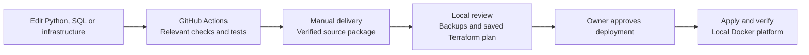

# RetailFlow

RetailFlow turns data from APIs into reliable retail analytics. We are building
the full journey: generate or retrieve data, preserve it, load a warehouse, check
its quality, and turn it into useful business reporting.

The platform runs locally using Docker and Terraform. Orders are synthetic;
exchange rates are real reference data retrieved from Frankfurter/ECB. No real
customer data is needed. A dashboard is a future step.

See the [operation and development guide](docs/runbook.md) for commands and setup.

## How the data moves

```mermaid
flowchart LR
    Orders["Synthetic orders API<br/>Ten European currencies"]
    FX["Frankfurter API<br/>EUR exchange rates"]
    Extract["Python extraction<br/>Airflow starts the API calls"]
    Blob["Azurite Blob Storage<br/>Orders: CSV · FX: original JSON"]
    Load["Python loading<br/>Verify batches and record lineage"]
    Raw["DuckDB<br/>Raw data and batch history"]
    Dbt["dbt<br/>Freshness checks, SQL models and tests"]
    Analytics["DuckDB views<br/>Clean orders, rates and EUR values"]
    Reporting["Future: reporting models<br/>Daily sales and business metrics"]
    Dashboard["Future: dashboard<br/>Explore sales and trends"]

    Orders --> Extract
    FX --> Extract
    Extract --> Blob --> Load --> Raw --> Dbt --> Analytics
    Analytics -.-> Reporting -.-> Dashboard

    classDef planned fill:#fff4cc,stroke:#9a7400,stroke-dasharray:5 5;
    class Reporting,Dashboard planned;
```

Solid arrows show the implemented data path. Dashed arrows show planned reporting
work. DuckDB holds both the raw tables and the transformed views. Airflow runs
the extraction, loading and dbt steps as one workflow for each source.

## What each part does

| Part | Its job |
| --- | --- |
| Synthetic orders API | Generates repeatable, realistic-looking orders in ten currencies. |
| Frankfurter API | Supplies date-specific exchange-rate reference data for conversion to EUR. |
| Azurite | Emulates Azure Blob Storage locally and preserves the retrieved batches for traceability and replay. |
| Python | Makes API calls, converts orders to CSV, verifies checksums and loads batches into the warehouse. |
| DuckDB | Stores the raw history, loading ledger and analytical views in a local warehouse. |
| dbt Core | Checks data freshness, transforms it with SQL and runs data-quality tests. |
| Airflow | Schedules work, manages dependencies, retries failed tasks and records run outcomes. |
| PostgreSQL | Stores Airflow's workflow metadata, such as run and task states. |
| Mailpit | Captures failure emails in a local browser inbox without an email-provider account. |
| Terraform + Docker | Create and run the local images, containers, networks and persistent volumes. |
| GitHub Actions | Checks changes and prepares verified source deliveries for local deployment. |

Orders run every ten minutes; exchange-rate extraction runs daily. Both pipelines
follow the same pattern:

**Extract → load → dbt freshness checks → dbt models and quality tests.**

## What makes the data trustworthy

Each layer has a purpose beyond moving data:

- **Keep the source evidence.** Land orders as CSV and preserve the original FX
  JSON, with checksum metadata linking batches to the warehouse.
- **Preserve history.** Record which batches were loaded and protect historical
  values against conflicting reloads.
- **Check before reporting.** dbt applies separate freshness rules for orders and
  FX, checks every required currency, and validates business rules.
- **Make currency differences visible.** Preserve original currency amounts and
  derive EUR values using date-specific rate lineage. Missing or stale rates stay
  visible, with unavailable EUR amounts left empty.
- **Protect the warehouse.** Coordinate database access with a shared lock, keep
  backups and use verified independent snapshots for DBeaver browsing.

When a DAG run finally fails, Airflow sends one event-based email to Mailpit.
Retries, successful runs and recoveries do not send emails. The standalone local
monitor reports operational health; data freshness belongs to dbt.

## Customer privacy demonstration

A versioned customer-linked order contract is prepared locally. Dummy customers
are generated **only for customer IDs referenced by the requested orders**.
The existing orders-v2/v3 history remains intact.

Before customer data reaches staging files, blobs or a warehouse, the new pipeline
removes direct contact details and birth dates, replaces the shared customer ID
with a keyed pseudonym, and keeps only country and age band. Orders and customers
retain the same protected join key. This demonstrates data minimization and
pseudonymization; it does not establish GDPR compliance or true anonymization.

Airflow integration and three customer dbt models are prepared locally for review.
The separate customer DAG starts paused; this extension has not yet been deployed.
See the [customer pipeline integration guide](docs/customer-pipeline.md).
See [privacy controls and their limits](docs/privacy.md). No real customer data
should be imported into this demonstration.

## How changes reach the running platform

Terraform manages infrastructure. Python manages extraction/loading logic, and dbt
manages warehouse transformations and checks. GitHub validates source and prepares
deliveries; deployment uses the existing local checkout and its protected data.
Your approval is sufficient: this is a single-maintainer project.

## Where we are heading

**Implemented:** API generation/retrieval, CSV/JSON blob landing, warehouse loading,
Airflow automation, dbt transformations/freshness/tests, EUR valuation, local failure
email, backups, database snapshots, and CI/delivery.

**Next:** reporting models that summarize daily sales, units sold, order counts
and EUR revenue. They should also expose missing-rate coverage so partial revenue
totals remain understandable. These models have been proposed and are not yet built.

**Future:** a dashboard built on those reporting models, for exploring sales over
time and comparing countries/products. Dashboard technology has not been selected.
Optional Azure/Snowflake targets remain future possibilities; the current platform
is a local engineering project, not a production cloud deployment.

For implementation details, see [orchestration](docs/orchestration.md),
[warehouse loading](docs/warehouse-loading.md), [dbt and failure alerts](docs/dbt-freshness.md),
[CI/delivery](docs/ci-cd.md) and [database browsing](docs/database-viewing.md).
