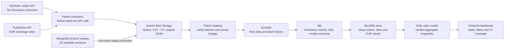
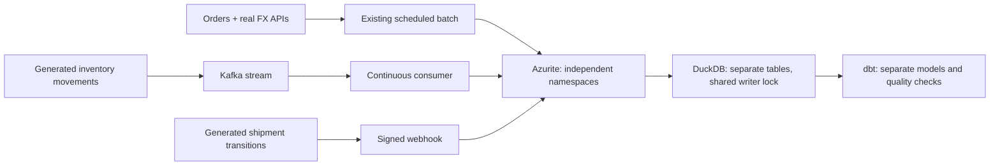
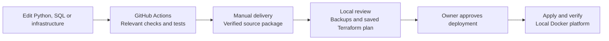

# RetailFlow

RetailFlow turns data from APIs into reliable retail analytics. We are building
the full journey: generate or retrieve data, preserve it, load a warehouse, check
its quality, and turn it into useful business reporting.

The platform runs locally using Docker and Terraform. Orders are synthetic;
exchange rates are real reference data retrieved from Frankfurter/ECB. No real
customer data is needed. The local Streamlit sales dashboard is available at
<http://127.0.0.1:8501> after the approved dashboard deployment.

See the [operation and development guide](docs/runbook.md) for commands and setup.

## How the data moves

Solid arrows show deployed data paths; catalog extraction currently runs on demand. The dashboard reads independent verified
aggregate snapshots. DuckDB holds raw tables and transformed views. Airflow runs
the extraction, loading and dbt steps as one workflow for each source.

## Three parallel ingestion paths

The streaming/event extension is deployed locally alongside the existing batch
pipelines, adding two independently generated datasets:

| Path | Data | Ingestion |
| --- | --- | --- |
| Batch — existing | Orders/customers and Frankfurter exchange rates | Scheduled API calls through Airflow |
| Streaming — deployed locally | Synthetic inventory movements | Kafka producer and continuous consumer |
| Event-driven — deployed locally | Synthetic shipment status changes | Authenticated webhook on each transition |

The new paths do not republish orders or add them to revenue totals. Inventory
references existing product IDs; shipments reference generated order IDs without
customer names or addresses. [Parallel ingestion design, tests and deployment](docs/parallel-ingestion.md).

## MongoDB product catalog

A MongoDB Community product catalog is **deployed locally**. It deterministically covers the existing 20
product IDs with electronics, apparel and homeware documents. Its independent
Terraform root, authentication, schema validation, indexes and verified recovery drill
leave the deployed pipelines and protected volumes unchanged. Reader-only
extraction into immutable Azurite JSON batches is deployed as a Terraform-managed
one-shot component. Its first 20-product batch and retry replay are verified;
there is no catalog schedule yet. Warehouse enrichment remains next.
See the [catalog design](docs/mongodb-catalog.md) and [extraction runbook](docs/mongodb-extraction.md).

## What each part does

| Part | Its job |
| --- | --- |
| Synthetic orders API | Generates repeatable, realistic-looking orders in ten currencies. |
| Frankfurter API | Supplies date-specific exchange-rate reference data for conversion to EUR. |
| Azurite | Emulates Azure Blob Storage locally and preserves the retrieved batches for traceability and replay. |
| Python | Makes API calls, converts orders to CSV, verifies checksums and loads batches into the warehouse. |
| DuckDB | Stores the raw history, loading ledger and analytical views in a local warehouse. |
| dbt Core | Checks data freshness, transforms it with SQL and runs data-quality tests. |
| Airflow | Schedules work, manages dependencies, retries failed tasks and records run outcomes. |
| PostgreSQL | Stores Airflow's workflow metadata, such as run and task states. |
| Mailpit | Captures failure emails in a local browser inbox without an email-provider account. |
| Terraform + Docker | Create and run the local images, containers, networks and persistent volumes. |
| GitHub Actions | Checks changes and prepares verified source deliveries for local deployment. |

Orders run every ten minutes; exchange-rate extraction runs daily. Both pipelines
follow the same pattern:

**Extract → load → dbt freshness checks → dbt models and quality tests.**

## What makes the data trustworthy

Each layer has a purpose beyond moving data:

- **Keep the source evidence.** Land orders as CSV and preserve the original FX
  JSON, with checksum metadata linking batches to the warehouse.
- **Preserve history.** Record which batches were loaded and protect historical
  values against conflicting reloads.
- **Check before reporting.** dbt applies separate freshness rules for orders and
  FX, checks every required currency, and validates business rules.
- **Make currency differences visible.** Preserve original currency amounts and
  derive EUR values using date-specific rate lineage. Missing or stale rates stay
  visible, with unavailable EUR amounts left empty.
- **Protect the warehouse.** Coordinate database access with a shared lock, keep
  backups and use verified independent snapshots for DBeaver browsing.

When a DAG run finally fails, Airflow sends one event-based email to Mailpit.
Retries, successful runs and recoveries do not send emails. The standalone local
monitor reports operational health; data freshness belongs to dbt.

## Customer privacy demonstration

A versioned customer-linked order contract is prepared locally. Dummy customers
are generated **only for customer IDs referenced by the requested orders**.
The existing orders-v2/v3 history remains intact.

Before customer data reaches staging files, blobs or a warehouse, the new pipeline
removes direct contact details and birth dates, replaces the shared customer ID
with a keyed pseudonym, and keeps only country and age band. Orders and customers
retain the same protected join key. This demonstrates data minimization and
pseudonymization; it does not establish GDPR compliance or true anonymization.

Airflow integration and three customer dbt models are prepared locally for review.
The separate customer DAG starts paused; this extension has not yet been deployed.
See the [customer pipeline integration guide](docs/customer-pipeline.md).
See [privacy controls and their limits](docs/privacy.md). No real customer data
should be imported into this demonstration.

## How changes reach the running platform

Terraform manages infrastructure. Python manages extraction/loading logic, and dbt
manages warehouse transformations and checks. GitHub validates source and prepares
deliveries; deployment uses the existing local checkout and its protected data.
Your approval is sufficient: this is a single-maintainer project.

## Where we are heading

**Implemented:** API generation/retrieval, CSV/JSON blob landing, warehouse loading,
Airflow automation, dbt transformations/freshness/tests, EUR valuation, local failure
email, backups, database snapshots, and CI/delivery.

**Implemented:** an opt-in daily sales dbt model and Terraform-managed
Streamlit dashboard, with country/product/date filters, exact EUR revenue and
explicit missing-rate coverage. It reads independent verified aggregate snapshots.
This milestone is deployed locally. See the [dashboard guide](docs/dashboard.md).

**Future:** inventory and shipment dashboard pages and richer reporting navigation.
The product catalog roadmap adds verified JSON extraction and dbt enrichment;
replica-set change streams remain a separate advanced milestone.
Optional Azure/Snowflake targets remain future possibilities; the current platform
is a local engineering project, not a production cloud deployment.

For implementation details, see [orchestration](docs/orchestration.md),
[warehouse loading](docs/warehouse-loading.md), [dbt and failure alerts](docs/dbt-freshness.md),
[CI/delivery](docs/ci-cd.md) and [database browsing](docs/database-viewing.md).
