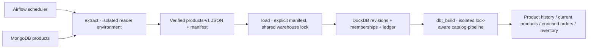

# Airflow product catalog workflow

Deployed locally on 2026-11-22. `retailflow_catalog` is **active** every six hours
UTC, with catchup disabled and one active run. The owner-approved activation and
[Streamlit reporting extension](catalog-dashboard.md) passed an immediate manual
verification run; the next future cron execution is recorded separately.

## Task behavior

`dags/retailflow_catalog.py` uses the existing Airflow runtime and DAG-level failure
callback. Each task retries twice with a one-minute delay. Only small manifest,
load and dbt summaries enter XCom; no source document or credential is returned.

The extraction task launches `/opt/catalog/venv/bin/python -I` with fixed script
and credential-file paths, a hashed run identity and a minimal child environment.
The MongoDB driver is installed only in that immutable child environment, not in
the Airflow interpreter, API runtime or dbt environment. Its separately locked,
hashed dependencies reuse `infra/mongodb/extraction/requirements.txt`.

The scheduler alone joins `retailflow-product-catalog` and receives read-only
mounts for `.local-secrets/mongodb/reader.json` and `azurite-key`. API-server and
DAG-processor receive neither catalog mount nor catalog network. No Docker socket,
MongoDB writer/admin identity or Terraform credential value is introduced. Only
the existing DAG-processor joins Mailpit's network for the established failure
callback; there is no new polling or email path.

Frozen retries, pending state and run receipts live in the protected Airflow state
volume under `catalog-products-v1`. This is separate from the earlier Terraform
one-shot extractor's state volume, which remains preserved. Snapshot sequences
are local to each extraction state, not globally unique identifiers. Both paths
land unique immutable batches; the warehouse reconciles product/revision hashes
and atomically records batch membership. A recovered older pending batch completes
first; it does not rewind state or guarantee exactly-once delivery. Subsequent
runs reconcile the current source again.

The load task reads only the extraction result's explicit manifest, verifies the
source contract/checksum again and uses the common warehouse FileLock (0660).
Scheduler UID 50000 accesses warehouse storage through group 10001 and setgid
2770 directories. All revision records, memberships and ledger rows commit in one
transaction. No other source namespace or historical facts are rewritten.

The plain dbt task invokes the isolated wrapper with `catalog-pipeline`, keeping
the warehouse lock through catalog source freshness, per-product freshness tests
and the tagged build. It bypasses sales publication and forwards no reader/blob
credential or secret-file environment variable. Per-attempt source/test/build
artifacts stay on the protected logs volume. The initial freshness SLA is 24 hours,
using snapshot retrieval time; a replay/load cannot reset it.

Product metadata changes only through supported source CRUD/revisions. A new
snapshot can confirm unchanged products; it does not manufacture random revisions.
The analytical joins use latest observed metadata, not historical order-time
validity, and preserve unmatched facts and original monetary units.

With the dashboard enabled, this task now selects `catalog-reporting-pipeline`:
order/FX/catalog/inventory freshness, four tagged freshness checks, eight selected
models and separate catalog reporting publication. It publishes only the new
catalog pointer, leaving the original sales reporting action intact. See the
[catalog dashboard contract and activation evidence](catalog-dashboard.md).

## Configuration and operation

`RETAILFLOW_CATALOG_ENABLED` defaults to false in `.env.example`; the deployed
ignored `.env` sets it to true. The existing infrastructure helper maps it to
`catalog_pipeline_enabled`. This enables runtime/network/mount configuration,
not the Airflow schedule. Changes need a reviewed saved plan and approved apply.
Keep deployed feature flags synchronized when preparing future main-platform plans.

The separate MongoDB Terraform root still requires `enabled=true` and
`extraction_enabled=true` for its existing protected foundation/one-shot resources.
Do not apply disabled defaults as a way to pause services. To pause the catalog
workflow, use its Airflow pause control. Source secrets remain ignored files, with
restricted NTFS ACLs and non-root readability checked before deployment.

The DAG is visible at the local Airflow UI, <http://127.0.0.1:8080>. It is active in
this installation after explicit owner approval; new installations still start
paused for verification. Do not change direct
database/file paths or mount the Docker socket to run tasks. Data freshness belongs
to dbt; operational monitoring remains the existing on-demand health report.

## Verified deployment

The reviewed saved plan replaced only the Airflow image and its init/three service
containers, plus the dbt image/container: seven resources. Existing API, dashboard,
Kafka, PostgreSQL and protected data volumes were not replaced. Prior DAG pause
states were recorded; active tasks drained, the scheduler and continuous workers
were stopped gracefully, and a locked warehouse snapshot plus 5,580 verified
landed blobs were preserved before applying. A pending orders dbt task remained
in metadata for normal resumption; no run or source checkpoint was deleted.

The catalog registered paused without import errors, then one controlled run
succeeded through extraction, loading and dbt. It loaded 20 products and built
four models with 19 passing build tests, alongside source/per-product freshness
checks. Verification retained all 3,182 orders and 416 inventory movements at
unchanged grain, quantities and amounts; every existing product reference matched.
All 5,580 pre-existing blob checksums were reverified after deployment. The source
reader, scheduler-only mounts/network and absence of a Docker socket were checked.
Private plans, backups and reports are under ignored
`artifacts/catalog-workflow-deployment/`.

The same run's extraction/load replay reused its existing manifest and inserted
no new revision or blob. Original DAG pause states and all four continuous workers
were restored. The on-demand platform report returned `ok`, and a post-deployment
Terraform plan showed no changes. Unrelated container IDs were preserved. A new
verified warehouse snapshot includes the catalog tables/views for independent
inspection.

Validation also passed 71 focused tests (one opt-in skipped), two real container
tests, Ruff, Bandit, SQLFluff, Terraform validation and source safety. The isolated
catalog dependency audit found no known vulnerabilities. Container tests cover
the real SDK graph, driver isolation, scheduler UID/GID loading/replay and the
complete catalog dbt wrapper, alongside existing DAG construction.

The catalog DAG was returned to paused after the first foundation verification;
the subsequent owner-approved activation is documented in the dashboard runbook.
This is local deployment
evidence, not a hosted-CI or production/compliance attestation. The repository
still requires separate explicit approval for committing/pushing this milestone.

See [product history and dbt enrichment](mongodb-warehouse.md),
[extraction recovery](mongodb-extraction.md) and [source governance](mongodb-catalog.md).
