# Customer pipeline integration

Status: prepared locally, not deployed. This adds a separate `retailflow_customers`
DAG and opt-in dbt models. Existing orders/FX workflows remain separate.
[Privacy controls and limitations](privacy.md) still apply; this is not a claim
of GDPR compliance.

```mermaid
flowchart LR
    API["Orders-v4 + referenced synthetic customers"] --> Extract["Airflow extract<br/>Minimize in memory"]
    Extract --> Stage["Masked retry stage + independent checkpoint"]
    Stage --> Blob["Azurite<br/>Orders CSV + customer JSON"]
    Blob --> Load["Airflow load<br/>Checksums + common lock"]
    Load --> Data["DuckDB privacy_demo<br/>Rows, snapshots, memberships, ledger"]
    Data --> Dbt["dbt<br/>Freshness → tests → customer build"]
    Dbt --> Views["Three customer views<br/>Protected joins; original minor units"]
```



## Scheduling and recovery

The DAG is defined every ten minutes, with no catchup, one active run, two retries
and the existing terminal-failure email callback. It starts paused and must stay
paused until deployment verification succeeds. XCom contains only cursor/batch
counts and dbt summaries. No retry, success or periodic email is added.

The first extraction requests the latest 20 orders and only their referenced
customers. Subsequent runs take up to 100 orders after the cursor; larger gaps
drain over subsequent runs. There is no unrelated customer population or automatic
full-history backfill. Intentional historical backfill requires separate review.

The checkpoint namespace is separate from orders-v2/v3 and partitioned by seed,
interval and key ID. Each run freezes its start position (or no-op decision).
Only minimized records are staged. Retries replay those exact bytes, and the
cursor advances only after downloaded files and the final manifest are verified.
An older retry cannot rewind the cursor. A keyed commitment rejects changing
key bytes behind an existing key ID.

Loading scans only `customer-orders/`. Under the shared 0660 FileLock, it commits
orders, dated snapshots, batch memberships and ledger atomically. Unknown fields,
changed manifests and historical conflicts fail. The ledger records load time
and public seed/interval/key ID for freshness. Legacy demo batches receive nullable
metadata columns without invented historical timestamps; those old rows cannot
satisfy current-profile ingestion freshness themselves.

## Key isolation and Terraform

Prepare a scheduler file from the existing ignored `.env` key:

```powershell
.venv\Scripts\python.exe -m retailflow.customer_ingestion prepare-key-file
```

This exclusively creates ignored `.local-secrets/customer.json` and refuses to
replace a different key. POSIX creation uses owner-only permissions where supported.
Check Windows host ACLs and readability as scheduler UID 50000 before deployment.
On Linux, explicitly arrange ownership/ACL access for that UID without making
the key public. Preserve a secure independent copy if historical joins are needed.
The source safety gate rejects `.local-secrets` files.

For a reviewed deployment set `RETAILFLOW_CUSTOMER_PIPELINE_ENABLED=true` and match
`RETAILFLOW_CUSTOMER_PRIVACY_KEY_ID` to the file. The infrastructure helper passes
only these public settings to Terraform. Enablement defaults to false, so unrelated
deployments do not silently mount a key. Terraform configures a read-only bind mount
into the scheduler only; API server/DAG processor do not receive it. The secret
never enters Terraform variables/state, image inputs, logs or dbt's child environment.
Host Docker administrators can still access mounted secrets.

Persist the intended public enablement setting in the ignored `.env` when the
deployment is approved, so later plans do not remove the mount. The prepared
review plan uses a process override; the running services have not been changed.

Follow the saved-plan/blob-backup process and preserve protected volumes. Before
a changing apply, pause/drain affected DAGs and take a locked warehouse snapshot.
Apply only the reviewed, owner-approved saved plan. Verify key readability without
printing content, controlled customer and legacy runs, and original blob checksums
before enabling the new schedule. No changing apply is part of this implementation.
Key rotation requires a new key ID and separate review.

## dbt models and checks

The shared lock-aware wrapper adds `customer-pipeline`: customer source freshness,
customer clock tests, then a customer-only build. Each phase retains separate
artifacts. Existing `pipeline` and normal builds keep customer resources disabled
unless `customer_pipeline: true` is explicitly supplied. No HMAC key or key-file
path enters the isolated dbt child environment.

| Model | Grain and purpose |
| --- | --- |
| `staging.stg_customer_orders` | Dataset/order; original minor units and token |
| `staging.stg_customers` | Dataset/token/snapshot date; country, age band, synthetic flag |
| `staging.customer_orders` | Every order with its latest customer snapshot delivered in the same batch |

Left joins preserve missing customers as NULLs and tests fail. Customer orders
are not merged into the existing EUR revenue model, avoiding duplicate revenue
across source versions. Checks cover uniqueness, required fields, accepted age
bands, token shape, totals, countries, missing customers, orphaned snapshots,
row counts and unexpected raw columns. dbt checks current seed/interval/key ID:
order generation and batch ingestion must be within 30 minutes. A separate test
rejects future order/load timestamps.

Validation uses disposable databases and network-isolated containers, including
the real Airflow SDK and isolated dbt as scheduler UID 50000. Deliberate missing/
orphaned customers, an added contact column and stale orders must fail. Image
rebuilds and live deployment verification are separate from development checks.

Local validation on 2026-11-04 passed 71 focused unit/regression tests and two
real runtime container checks; two unrelated opt-in integrations
were skipped. The healthy customer build produced three views and 17 passing
data tests, plus two source-freshness checks and one clock test. All four deliberate
corruptions failed. A separate real dbt parse confirms default builds retain only
the existing three models and 37 tests. Ruff, Bandit, source-secret scanning and
Terraform validation passed.

The final saved review under ignored `artifacts/customer-integration-review-20261104-final`
contains nine image/container replacements and no volume changes. DuckDB, Azurite
and PostgreSQL containers remain unchanged; 1,180 original blobs were backed up
and their checksums verified. Plan inspection confirmed the scheduler-only
read-only key mount and absence of the actual HMAC key. Apply, live warehouse
schema migration and activation remain unperformed.

This final plan supersedes the earlier review directory without deleting it.
The scheduler UID read-access check passed, and Windows ACL inspection found
only owner, system and administrator allow entries on the prepared key file.
