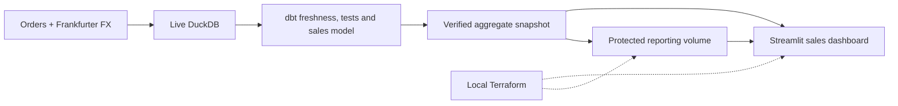

# Streamlit sales dashboard

Status: implemented for local review; not deployed or published to GitHub yet.
The first milestone covers sales. Inventory and shipment pages are future work.

## What the page shows

The page has order-date, dataset, country, product and original-currency filters;
covered EUR revenue, order count, units and valuation coverage; daily revenue and
order charts; and product performance. Exactly one dataset profile is selected,
so differently configured synthetic generators are never combined accidentally.

The opt-in dbt `daily_sales` table groups by dataset, UTC date, country, product
and original currency. EUR revenue sums the existing exact per-order EUR cents.
Missing/stale/unsupported rates remain in order and unit counts and are explicitly
excluded from EUR revenue. Groups with no covered orders retain NULL revenue;
the page shows unavailable revenue rather than implying a complete zero total.
KPI formatting uses integer cents. Floating-point coordinates are used only for
visual charts. The model's reconciliation test compares every aggregate with
the underlying `orders_eur` rows.

## Publication and isolation

Enablement defaults to false. When enabled, the existing orders and FX dbt tasks
invoke `reporting-pipeline`: source freshness, tagged freshness tests, full batch
build with `sales_reporting: true`, then publication. The publisher shares the
same reentrant FileLock for the entire build/test/publication operation. Other
writers cannot change the tested data between those steps. Existing default
builds, customer builds and event analytics do not publish sales snapshots.

Python creates a separate DuckDB file containing **only the sales aggregate**.
It checks its schema, row contract, keys and closed bytes, writes checksum metadata
last, then atomically replaces `current.json` after publishing the new immutable
version directory. The dashboard validates the version path, manifest, checksum,
table inventory, columns and row counts before opening it read-only. It receives
no live warehouse mount, blob key, Airflow credential or customer/HMAC key.

A failed build/publication leaves the previous pointer and version unchanged.
Missing initial data produces a waiting screen. Invalid published data produces
a sanitized error instead of displaying unverified results. Publication failures
fail the Airflow task through the existing failure/retry path. Publication is
not an exactly-once or cross-filesystem crash-durability claim.

Each page refresh or **Refresh data** click checks the current version. Cached
data is keyed by immutable version; switching snapshots opens the new file and
never overwrites a file that an older reader might still hold. The page shows
publication time and latest included order time. It does not independently
implement freshness tests or continuously poll the live warehouse.

## Terraform and operation

`infra/local/dashboard.tf` owns the image, container, dedicated bridge, protected
reporting volume and non-root permission initializer. The dashboard has a 512 MiB
memory limit, dropped capabilities, read-only root filesystem, temporary scratch
space and loopback-only port **8501**. Its reporting mount is read-only; only the
scheduler receives a writable mount, through existing group 10001. The volume
root is mode 2770, files are group-readable, and publication locks use mode 0660.

The runtime has an independent Python 3.12 project/lock under `infra/dashboard`.
DuckDB, filelock and pytz match the existing runtime. Image installs use exported
hashes. Streamlit dependencies are not added to the API or Airflow environments.
CI audits the lock, builds the validation image and runs disposable UI/dbt tests.

Local validation passed focused regression tests, a real dbt reporting pipeline,
Streamlit AppTest rendering/filter checks and a production-command HTTP health
smoke test. The integration used scheduler UID 50000 with group 10001 for
publication, and dashboard UID 10001 with a read-only reporting mount. It verified
exact EUR totals, visible FX gaps and retention of the last report after deliberate
disposable source corruption caused dbt to fail. A separate real parse confirmed
the default selection still has three models and 37 tests. No validation workload
read or changed the live warehouse; the saved Terraform preview preserved every
existing data volume. The image, configuration and app are not yet deployed.

After an approved deployment, open <http://127.0.0.1:8501>. To prepare enablement,
set `RETAILFLOW_DASHBOARD_ENABLED=true` in the ignored `.env`, then follow the
[saved-plan and backup deployment workflow](ci-cd.md). A reviewed image/container
update is required; editing `.env` does not change running services. No live
enablement, Terraform apply, commit or push is part of this preparation milestone.

## Governance, costs and limits

The repository owner owns this derived reporting dataset. Classification is
synthetic aggregate sales and public reference FX. Lineage is the tested dbt
model and upstream batch manifests; this is for local engineering/demo analytics,
not financial settlement. Direct customer records and tokens are excluded.
Aggregation/checksums do not establish anonymization, GDPR compliance or RBAC.

Local Docker/Streamlit requires no mandatory subscription or cloud account. The
dashboard adds up to 512 MiB of container memory plus a temporary initializer.
The bridge allows outbound connectivity; telemetry is disabled. The loopback UI
has no authentication and is intended for one trusted local operator. Publishing
it outside the machine requires a separate authentication/TLS/security review.

Publication fails rather than truncating above 100,000 rows or 64 MiB per report.
Versions, pending failed attempts and backups have manual retention; no automatic
deletion is implemented. Storage therefore grows and requires owner-managed
retention. Never delete versions that readers may still use, or promote a report
back into the live warehouse. Inventory and shipment reporting, automatic browser
refresh and richer BI navigation remain future milestones.

References: [Streamlit Docker deployment](https://docs.streamlit.io/deploy/tutorials/docker),
[Streamlit AppTest](https://docs.streamlit.io/develop/api-reference/app-testing).
