# MongoDB product catalog: design and first milestone

Status: foundation deployed locally on 2026-11-19 from CI-verified commit
`f6ae472`, through an owner-approved catalog-only saved plan. The deployment added
eight resources, with no existing-resource replacement or deletion. The default
Terraform configuration remains disabled for other installations; use
`-var='enabled=true'` when reviewing the deployed catalog's state.

## Existing integration points

Orders in `retailflow/api.py` and inventory in `retailflow/event_contracts.py` both
generate exactly `product-001` through `product-020`. That is the catalog's full
key space. Order identifiers, dataset profiles, price/minor-unit contracts and
inventory events remain unchanged. Existing sources do not identify product
variants: enrichment must not invent which variant an order purchased.

The existing platform already has immutable Azurite landing, payload/checksum
verification, frozen retries, transactional DuckDB loaders, batch ledgers and
memberships, Airflow, opt-in dbt models and snapshot-based reporting. Future
catalog extraction will reuse these boundaries rather than introduce another
orchestrator, warehouse or storage abstraction. DuckDB readers/writers/backups
continue using the shared FileLock (0660), group 10001 and directory mode 2770.
Catalog work must never attach a desktop client to the live warehouse.

The first catalog Terraform root is deliberately independent at
`infra/mongodb/terraform`. It uses the same local Terraform 1.17.1 and pinned
Docker provider 4.6.0 but separate state/network/volumes. Nothing is added to the
existing Airflow/API build contexts or Python dependencies. This avoids rebuilding
or disturbing deployed services simply to introduce an operational document store.

## Document design and field definitions

`retailflow.products` stores one bounded document per product. Examples below
omit common fields for readability; dates are stored as BSON dates, not strings.

| Example | Product/SKU | Category-specific attributes | Embedded variants |
| --- | --- | --- | --- |
| Electronics | `product-001` / `RF-0001` | `power_watts: 11`, `warranty_months: 24` | `RF-0001-A: black`, `RF-0001-B: white` |
| Apparel | `product-002` / `RF-0002` | `fabric: cotton`, `care_temperature_c: 30` | `RF-0002-A: M`, `RF-0002-B: L` |
| Homeware | `product-003` / `RF-0003` | `material: ceramic`, `dishwasher_safe: true` | `RF-0003-A: black`, `RF-0003-B: white` |

All 20 products initially support the 11 existing country codes, avoiding a
contradiction with orders already generated in those markets. Later availability
changes describe current operational state, not a retroactive rule for old orders.
Seed timestamps are deterministic UTC instants in December 2024, before the
order generator's January 2025 epoch. Repeating a seed never updates existing
documents or resets operational revisions/retirements.

| Field | Definition and contract |
| --- | --- |
| `_id` | Existing stable product ID, restricted to the 20 source-compatible values; MongoDB primary key |
| `sku` | Unique product SKU, deterministic at seed time; public business identifier |
| `name` | Bounded synthetic product label; no real-person data permitted |
| `category` | `electronics`, `apparel` or `homeware` |
| `attributes` | Category-specific object; required fields, allowed values and numeric ranges are validated |
| `variants` | One or two embedded `{sku, option}` records; category-specific option values |
| `markets` | Nonempty unique array of supported country codes |
| `schema_version` | Structural contract version, initially integer `1`; unknown versions rejected |
| `revision` | Positive business-document revision; helper updates use compare-and-swap |
| `synthetic` | Required boolean `true` |
| `classification` | Required `synthetic_product_metadata` |
| `status` | `active` or `retired`; retirement preserves historical references |
| `created_at` | BSON UTC creation date; stable under the application helper |
| `updated_at` | BSON UTC revision date, not earlier than creation; MongoDB stores millisecond precision |

Embed attributes/variants/availability because these small, bounded values are
read with the product and updated atomically. Reference the product from orders
and inventory using the stable `_id`; do not embed unbounded order, review or
inventory histories. No catalog price replaces the original order amount.

The generated `contract.json` is used by MongoDB at initial bootstrap and checked
against the Python model in tests. Strict/error validation rejects unknown fields,
wrong category shapes, invalid types/dates and unknown schema versions. A separate
expression prevents duplicate variant SKUs inside one document: a unique multikey
index alone does not enforce uniqueness within a single array.

Indexes are `_id` (implicit unique), `sku_unique` (unique),
`category_market_status` (category + market array + status), `incremental_cursor`
(`updated_at`, `_id`) and `variant_sku_unique` (unique multikey across documents).
Only one array field participates in the category/market compound index.
`explain` compares unhinted and index-hinted execution statistics; tests compare
indexed and forced collection scans with identical results. Twenty documents are
too few to claim representative latency gains, and an unhinted COLLSCAN may be a
reasonable optimizer choice. Hints demonstrate access paths, not benchmark wins.

## Target architecture and roadmap

```mermaid
flowchart LR
    Seed["Python deterministic seed / manual CRUD"] --> Mongo["MongoDB products · first milestone"]
    Mongo -.-> Extract["Python extraction · planned"]
    Extract -.-> Blob["Azurite immutable Extended JSON + manifest"]
    Blob -.-> Warehouse["DuckDB version history + atomic batch ledger"]
    Warehouse -.-> Models["dbt products + tested enrichment"]
    Models -.-> Analytics["Orders / inventory / dashboard"]
```



| Stage | Scope | Acceptance criteria |
| --- | --- | --- |
| 1 — this milestone | Isolated Community server, deterministic seed, validation/indexes, CRUD/query examples, security and recovery drill | 20 compatible IDs; all categories; authenticated least-privilege access; rejection tests; restart persistence; new-target restore; no existing-volume writes |
| 2 — reviewed extraction | Reader-only Python extraction to a separate `product-catalog/products-v1/` Azurite namespace | Frozen canonical Extended JSON preserves BSON date/numeric types; downloaded-byte verification; manifest last; immutable conflicts rejected; retries reuse bytes; checkpoints advance after verified manifests |
| 3 — warehouse/dbt | Append product document versions, atomic memberships/ledger, product models and enriched analytics | Reuse warehouse lock; reject conflicting `(product_id, revision)` payloads; preserve schema version, source manifest and hashes; left joins retain unmatched facts; no multiplication of order count/revenue; freshness belongs to dbt |
| 4 — optional CDC | Separately reviewed replica-set topology and change-stream extraction | Persist/resume tokens only after verified landing; replay idempotently; handle expired tokens/history gaps, deletes and reconciliation; test crashes and backpressure |

Start stage 2 with bounded full snapshots of this 20-document catalog and
revision/hash reconciliation. Incremental extraction can then add `(updated_at,
_id)` keyset pagination with overlap, frozen boundaries and periodic full
reconciliation. A timestamp-only cursor misses equal-millisecond, late/backdated
or uncoordinated updates. Application CAS/clock discipline is not server-enforced
immutability for every possible database writer, so do not claim lossless CDC
from that cursor. Hard deletes are not supported by incremental polling; use
retirement tombstones and retain them until all consumers have reconciled.

Delivery is at least once. Warehouse history should keep source ID, revision,
schema version, update time, payload hash, ingestion time and manifest membership.
Use the current batch-ledger transaction convention, with reviewed new product
membership tables. Do not overwrite older product versions or silently alter
existing order/FX namespaces. Historical enrichment must distinguish observed
catalog validity from unobserved history; never invent past attributes. New DAGs
must start paused and pass retry/reconciliation tests before activation.

Schema evolution is planned: version 2 needs a reviewed validator expansion,
explicit migration preserving identities/timestamps/revisions, compatibility
tests and eventual removal of version 1 only after consumer migration. Restarting
the container does not rerun initial schema setup on an existing volume. No
automatic `collMod` or migration is performed now.

Change streams require a replica set or sharded cluster; this first deployment
is intentionally standalone. A single-node replica set would demonstrate resume
mechanics but would not provide high availability. See [MongoDB change streams](https://www.mongodb.com/docs/manual/changestreams/).

## Security, ownership and governance

The repository owner owns the catalog and its derived datasets. Classification
is synthetic operational metadata. Approved uses are local engineering,
document/index experiments and analytical enrichment demonstrations. Real
personal data and real production catalog imports are prohibited. The synthetic
flag is not a semantic PII detector: a privileged user could still put sensitive
text into an allowed string field. This does not establish GDPR compliance.

| Identity | Effective authority |
| --- | --- |
| `catalog_reader` | Find products; inspect product indexes and collection metadata for explain/backup. No insert/update/delete, schema or identity administration |
| `catalog_writer` | Find/insert/update products only. No physical delete, schema/index administration, user/role management or validation bypass |
| `catalog_admin` | Separate bootstrap/recovery root administrator. Never mounted into seed/reader application containers |

`Catalog.seed` uses idempotent `$setOnInsert` upserts. `get`, nested variant
queries, market queries and category aggregations demonstrate reads. `revise`
accepts only mutable fields and uses the expected revision plus increasing
timestamp; `retire` is an update, not physical deletion. The Python helper checks
identifier/revision inputs as scalars before database calls, so query
operator objects cannot stand in for business keys or optimistic revision values.
MongoDB enforces collection/schema permissions; field immutability and CAS are helper policy, not
field-level RBAC. Other writer clients must follow that policy.

The server runs as UID/GID 999, client jobs as 10001, with dropped capabilities,
read-only root filesystems and temporary scratch space. Its dedicated Docker
network is internal, has no published database port, and is not attached to
Airflow, Azurite or the existing platform networks. TLS is not configured for
this trusted local boundary; this is not a production network-security claim.
The server memory cap is 1 GiB, with 128 MiB one-shot clients.

Random credentials live only in ignored host files and read-only bind mounts.
Terraform receives file paths, never credential values or `file()` secret contents.
Tests confirm passwords are absent from Docker configuration, saved Terraform
plan data and server logs. The official entrypoint must read bootstrap secrets
inside the container; host/Docker administrators and a compromised database
container can access mounted secrets. This is not a managed secret vault.
POSIX generation uses directory 0700/files 0600. Windows chmod is not an NTFS ACL
control: restrict and review the host ACL before any deployment. Existing legacy
platform Terraform states may contain other credentials; the new separate
catalog state does not remediate or import those states.

Community diagnostic/authentication logs are operational evidence, not a complete
tamper-resistant CRUD audit trail. Enterprise's native auditing and encrypted
WiredTiger features are not enabled or claimed here. Profiler/query logging is
not a substitute for an audited history and can itself expose document values.
No profiler or query-payload logging is enabled by this milestone. Logical
revisions and sanitized CLI summaries are not an immutable audit log. See
[MongoDB auditing](https://www.mongodb.com/docs/manual/core/auditing/) and
[encryption at rest](https://www.mongodb.com/docs/manual/core/security-encryption-at-rest/).

Retain documents, retirements, operational logs and backups manually; there is no
TTL or automatic deletion. Physical deletion requires owner approval, reference
impact review, a verified backup and downstream tombstone/reconciliation handling.
Backups inherit synthetic classification and remain unencrypted local files.
Host disk encryption/off-host backups are separate controls, not implemented.
Never remove data volumes to recover a failed password/schema bootstrap.
Credential rotation needs coordinated database-user updates and file/container
refresh; replacing files alone does not rotate stored MongoDB identities.

## Running locally after explicit deployment approval

All commands start at the repository root with Docker Desktop's Linux engine.
They concern only the separate catalog root; do not run a plan/apply in `infra/local`.

```powershell
# Generates credentials without printing them; refuses an existing directory.
.venv\Scripts\python.exe infra/mongodb/catalog.py init-secrets

# Restrict the new credential directory on Windows; do not weaken inherited ACLs.
$catalogSecrets = (Resolve-Path .local-secrets/mongodb).Path
$ownerSid = [System.Security.Principal.WindowsIdentity]::GetCurrent().User.Value
icacls $catalogSecrets /inheritance:r /grant:r "*${ownerSid}:(OI)(CI)F" "*S-1-5-18:(OI)(CI)F" "*S-1-5-32-544:(OI)(CI)F"
Get-ChildItem -LiteralPath $catalogSecrets -Force -File | ForEach-Object {
    icacls $_.FullName /inheritance:r /grant:r "*${ownerSid}:F" "*S-1-5-18:F" "*S-1-5-32-544:F"
    if ($LASTEXITCODE -ne 0) { throw 'Credential-file ACL update failed' }
}
icacls $catalogSecrets

$catalogTerraform = (Resolve-Path .bootstrap/terraform/terraform.exe).Path
& $catalogTerraform -chdir=infra/mongodb/terraform init -lockfile=readonly
& $catalogTerraform -chdir=infra/mongodb/terraform validate
# Default enabled=false creates nothing. Use an ignored, absolute saved-plan path:
$catalogPlan = Join-Path (Resolve-Path artifacts).Path 'catalog-reviewed.tfplan'
& $catalogTerraform -chdir=infra/mongodb/terraform plan -var='enabled=true' -out=$catalogPlan
# Review the additive scope and protected storage, then obtain owner approval.
# Only after that approval:
& $catalogTerraform -chdir=infra/mongodb/terraform apply $catalogPlan

docker inspect retailflow-catalog-seed --format '{{.State.ExitCode}}'
docker inspect retailflow-catalog-verify --format '{{.State.ExitCode}}'
docker logs retailflow-catalog-verify
```

Expect both client exit codes to be zero and verification total `20`. Terraform
one-shot creation alone is not evidence that seeding succeeded. Verification
depends on the seed job and fails if the 20-ID catalog is incomplete. Public
container names, usernames and secret file paths are configuration metadata;
never print the files, full Docker inspection output, state or full plan JSON.
The Windows path is normalized to Docker Desktop's Linux VM mount path. A Linux
host can use `-var='docker_host=unix:///var/run/docker.sock'`, but must separately
review host file ownership/secret readability for UIDs 999 and 10001 before apply.
No automatic permission weakening is provided for that case.
On Windows, inheritable directory grants alone can leave files inaccessible.
Apply explicit file grants as above, inspect their effective ACLs and verify
non-root read access through a read-only mount before applying. The local
deployment verified owner/SYSTEM/Administrator access and both runtime UIDs.

To re-seed without overwriting operational changes, run
`docker start -a retailflow-catalog-seed`; verify with
`docker start -a retailflow-catalog-verify`. Use reader-only explain diagnostics:

```powershell
$catalogReader = (Resolve-Path .local-secrets/mongodb/reader.json).Path
docker run --rm --network retailflow-product-catalog --read-only --cap-drop ALL --security-opt no-new-privileges:true --mount "type=bind,source=$catalogReader,target=/run/secrets/catalog.json,readonly" retailflow-catalog:local explain
```

The Python `Catalog` API provides the manual CRUD/query examples used by tests.
It has no arbitrary external URI option. Use `docker stop --timeout 60
retailflow-mongodb` for a graceful WiredTiger shutdown, and `docker start
retailflow-mongodb` to resume with the same protected data volume. Restart
persistence was verified for the deployed catalog without restarting other services.

## Backup and new-target recovery

Backups use a separate protected `retailflow-mongodb-backups` volume. Quiesce all
catalog writers first; this standalone logical dump is not a transactional online
snapshot across collections. No continuous writers are scheduled in milestone 1.
The explicit acknowledgement below is an operator assertion, not a distributed
write lock. `mongodump` reads through the restricted reader; a temporary mode-0600
tool configuration carries the password rather than command-line arguments.
Archives are flushed, SHA-256/length metadata is published last, and a pending
directory is renamed only on success. Failed attempts remain unpublished.

```powershell
# Only after stopping external/manual catalog writers:
docker exec -e CATALOG_WRITERS_QUIESCED=true retailflow-mongodb mongosh --quiet --nodb --file /opt/catalog/backup.js
# The result contains a non-secret completed bundle ID. Verify a recovery drill:
docker exec -e CATALOG_BACKUP_ACTION=restore -e CATALOG_BACKUP_BUNDLE='<bundle-id>' retailflow-mongodb mongosh --quiet --nodb --file /opt/catalog/backup.js
```

Recovery verifies the archive checksum before invoking `mongorestore`, generates
a fresh `catalog_restore_<uuid>` database, and refuses an existing target. It
never passes `--drop` or restores over `retailflow`. Validation/index metadata
and retired documents are retained. Users/roles are not restored or automatically
granted access to the new database. There is no automatic promotion, expiry or
cleanup; remove a drill target only after explicit owner approval. Copy completed
bundles off-host manually if needed; both local volumes share Docker/host failure
risk. The archive checksum is integrity evidence, not an authenticated signature.
Tool failures expose only sanitized status; credential-redacted diagnostics may
remain in protected container scratch space. See [MongoDB Tools password-file guidance](https://www.mongodb.com/docs/database-tools/mongodump/).

## Validation and optional Atlas compatibility

Local tests use anonymous volumes and `mongo-fixture-<uuid>` networks/containers,
then remove only those generated resources. They demonstrate deterministic ID
coverage, schema/extra-field/type/category rejection, SKU uniqueness, nested
queries, aggregation, CAS/soft deletion, reader/writer/admin separation, rejected
unauthenticated reads, indexed explain equivalence, restart persistence, a
new-target backup restore and corrupt-archive rejection. No test mounts an existing
platform data volume. Terraform preflight checks default-disabled mode, additive
enabled plans, no published port and absence of generated passwords from plan data.
A network-disabled root fixture initializer copies only the test's temporary
credentials into separate anonymous volumes with appropriate Linux ownership;
the server/client workloads stay non-root and each client mounts only its own
identity. Host secret file permissions are not weakened to accommodate CI.
The local checks passed 27 focused catalog/CI-selection tests and the real MongoDB
security/restart/recovery integration, plus Ruff, Bandit, dependency auditing,
workflow validation, source safety and Terraform validation/preflight. All five
jobs passed in [the exact-source CI run](https://github.com/ungvari-tomi/tomi-platform/actions/runs/44597498892).

Live verification confirmed 20 products (7 apparel, 7 electronics, 6 homeware),
40 variants, the strict validator and all five indexes. Actual application
privileges matched the restricted role definitions. No credential values were
found in Docker configuration, server logs or catalog Terraform state. A completed
backup was transferred and checksum-verified, then restored into a fresh
`catalog_restore_<uuid>` database with its documents, validator and indexes.
That recovery database and backup remain available for owner review; neither
was promoted or auto-deleted. Existing platform container IDs stayed unchanged,
and its on-demand health report returned `ok`. Deployment evidence is retained
under ignored `artifacts/mongodb-deployment/`; Terraform reported no changes.

```powershell
docker build -f infra/mongodb/server.Dockerfile -t retailflow-mongodb:validation infra/mongodb
docker build -f infra/mongodb/client.Dockerfile -t retailflow-catalog:validation infra/mongodb
$env:RETAILFLOW_TEST_MONGODB_IMAGE = '1'
.venv\Scripts\python.exe -m pytest -q -p no:cacheprovider tests/test_mongodb_catalog.py tests/test_mongodb_container.py
```

Atlas M0 is documentation-only: no Atlas provider, account, cluster or paid
resource is created. A later compatibility review must verify current limits,
TLS/SRV endpoints, narrow IP allowlists, credential storage, available roles,
backup/restore behavior and application tests; the present local endpoint allowlist
deliberately rejects Atlas. Free clusters currently have a 0.5 GB limit and
automatic idle pause. Optional Free-cluster backup subscriptions can be chargeable;
never enable them silently. Check current [M0 limits](https://www.mongodb.com/docs/atlas/reference/free-shared-limitations/)
and [Free-cluster backup pricing](https://www.mongodb.com/docs/atlas/backup/cloud-backup/free-cluster-backup/)
before choosing any cloud option. Self-hosted Community here requires no
subscription or expiring trial; host RAM/disk are still finite resources.
