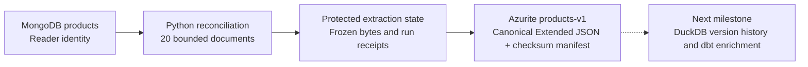

# MongoDB catalog extraction

Status: deployed locally on 2026-11-19 through the owner-approved saved plan.
The deployment added only the extraction image, container and protected state
volume; existing catalog/platform resources were unchanged. The default remains
disabled for new installations. There is no new Airflow schedule, warehouse
load, dbt model or change stream in this milestone.



## Behavior and recovery

`infra/mongodb/extract.py` reads all 20 known product IDs, including retired
products. This is bounded reconciliation rather than a timestamp cursor. Each
document is serialized as canonical MongoDB Extended JSON, preserving BSON dates
and numeric types. Documents are ordered by product ID; object keys are sorted.

The extractor checks required field names, synthetic classification, supported
schema version, positive revisions, complete identity coverage, and per-product
revision/hash consistency. MongoDB remains responsible for the complete nested
document validator. Unexpected fields, a disappearing product, an older revision
or different content under the same revision fail before staging a new batch.
Allowed strings are not scanned for personal information; the synthetic flag
does not establish privacy compliance.

Each invocation acquires a source-specific 0660 FileLock on its state directory.
It freezes the payload, ingestion time, batch ID, run-identity hash and next
checkpoint sequence using fsynced temporary files and atomic replacement.
The shared `retailflow.batch_landing` contract then:

1. Uploads `data.json` without overwriting different bytes.
2. Downloads the bytes and verifies SHA-256.
3. Publishes `metadata.json` last and verifies its bytes.
4. Verifies the downloaded batch again before advancing the checkpoint.

Blobs use the separate namespace
`product-catalog/products-v1/ingestion_date=YYYY-MM-DD/batch=<uuid>/`.
Manifests identify `retailflow.products`, `products-v1`, the serialization format,
row count, sequence, classification, payload size and checksum. No credentials or
raw run IDs enter manifests. Existing orders, FX, customer and event prefixes are
untouched. `retailflow.landing` re-exports the shared functions, preserving callers.

A failed upload leaves `pending.json`. The next invocation completes that frozen
batch without querying the source, even when invoked with a different run ID.
If it recovered an older run, invoke the new run again to take its own snapshot.
Run receipts preserve verified replay after subsequent runs without rewinding
the latest checkpoint. Recovery also handles a crash between publishing the
checkpoint and removing the pending file. Never manually rewind a checkpoint or
edit frozen bytes; inspect the failure and recover the original state instead.

Delivery remains at least once. A full read is not a multi-document transactional
snapshot; concurrent writes can appear across successive snapshots. Intermediate
revisions between polls are not guaranteed. Same-revision changes, missing IDs
and backdated updates are reconciled against the previous verified snapshot.
Retirement is a retained document, not a physical delete. State-file fsync and
atomic replacement are tested for process-crash recovery, not a guarantee against
all host/storage power-loss behavior. Future CDC remains a separate replica-set
milestone.

## Security and ownership

The repository owner owns source and landed synthetic product metadata. Approved
uses remain engineering demonstrations and eventual product enrichment. The
extractor mounts only the MongoDB reader identity and local Azurite key, never
writer/admin identities, Docker socket or warehouse storage. It runs as UID/GID
10001 with a read-only root filesystem, dropped capabilities, no published ports
and a separate protected state volume. The image has its own minimal build
allowlist and independently locked, hashed dependencies; PyMongo is development
only in the root project and is not added to API/Airflow runtime dependencies.
The build uses Docker BuildKit and its Dockerfile-specific ignore file.

Only the extractor joins both the catalog network and the existing Azurite
network. This increases its reachable services; MongoDB itself retains its
internal network and no host port. The emulator account key grants account-level
access, not prefix-scoped Azure RBAC. Namespace separation and no-overwrite
checks are application controls, not WORM storage. The source reader cannot write
or administer MongoDB, but a compromised extractor holding the emulator key
could affect other blobs. A future cloud integration needs separate review.

Secrets are read from ignored files at runtime. Terraform stores public mount
paths, not credential contents. The blob-key-file option loads the key into the
extractor process environment, not Docker container configuration; privileged
host/process inspection remains a risk. Errors print only their exception type.
Preserve Windows owner/SYSTEM/Administrators-only ACLs described in the
[catalog runbook](mongodb-catalog.md).

There is no automatic deletion of landed history, state, receipts or backups.
Retain complete source-to-landing lineage and checkpoint state together for
recovery. Explicit owner review is required for retention cleanup or resetting
state. The state volume is not a backup; arrange a consistent, quiesced copy of
it alongside a verified landing backup before a later deployment or recovery.
Community Edition audit/encryption limitations remain as documented for the source.

## Verify without touching deployed data

From the repository root, with Docker already running:

```powershell
uv sync --locked
docker build -f infra/mongodb/server.Dockerfile -t retailflow-mongodb:validation infra/mongodb
docker build -f infra/mongodb/client.Dockerfile -t retailflow-catalog:validation infra/mongodb
docker build -f infra/mongodb/extraction/Dockerfile -t retailflow-catalog-extraction:validation .
$env:RETAILFLOW_TEST_MONGODB_IMAGE = '1'
uv run --locked python -m pytest tests/test_mongodb_extraction.py tests/test_mongodb_container.py -q -p no:cacheprovider
Remove-Item Env:RETAILFLOW_TEST_MONGODB_IMAGE
```

The container test creates a uniquely named internal network, generated credentials,
MongoDB and Azurite with anonymous disposable storage, and a reader-only extraction
client. It verifies BSON fidelity, replay and immutable conflicts, plus existing
role enforcement, validation, indexes, restart and new-target recovery. Its cleanup
removes only its own fixture containers, network and anonymous volumes.

Local milestone validation on 2026-11-19: 54 focused unit/regression tests and
two container tests passed. These cover the complete real MongoDB/Azurite path
and the extraction image's non-root state-volume ownership/0700 permissions.
Ruff lint/format, Bandit, source safety scanning, workflow syntax validation,
Terraform formatting/validation and the extractor dependency audit passed; the
audit reported no known vulnerabilities. A private saved-plan preflight showed
exactly three creations (extractor image, state volume and container), with no
existing-resource changes. That preflight was not applied; deployment used a
separate refreshed saved plan. Hosted CI results are separate from these local checks.

## Deployment and operation

`infra/mongodb/terraform/extraction.tf` prepares an optional one-shot image,
protected `retailflow-catalog-extraction-state` volume and container. It references
the existing Azurite network without taking ownership of its resources. Enabling
it performs a real landing write, so review and approval are required first.

Before planning, create `.local-secrets/mongodb/azurite-key` from the existing
local emulator key using a private local process. Do not generate a replacement
key, paste it into Terraform, or mount the whole `.env`. Apply the same restricted
file ACLs as the other catalog credentials and verify it is readable by the
non-root container. This file was prepared and its restricted ACLs and non-root
mount were verified for the approved local deployment; it remains ignored.

After backing up landed blobs, prepare a saved plan:

```powershell
terraform -chdir=infra/mongodb/terraform plan -var='enabled=true' -var='extraction_enabled=true' -var='extraction_run_id=manual-1' -out=extraction.tfplan
```

Keep `enabled=true` for the already deployed catalog. Review the plan privately;
do not print or publish plan JSON/state. Expect only the three opt-in extraction
resources when the catalog itself has no drift. Inspect any additional changes.
Apply only the reviewed saved plan after explicit approval. Treat exit code 0
and a verified new products manifest as acceptance evidence;
Terraform completion alone is insufficient. The one-shot container remains stopped
after success. For a new snapshot, review a plan with a new `extraction_run_id`;
restart the unchanged container to retry its existing identity. Do not disable the
feature to pause it: `prevent_destroy` intentionally protects its state volume.
For this deployed installation, always pass both `enabled=true` and
`extraction_enabled=true` when planning, preserving `extraction_run_id=manual-1`
unless a new snapshot is explicitly intended. Applying defaults would propose
removing protected resources and must not be used as a shutdown procedure.

The first deployed manifest is:

```text
product-catalog/products-v1/ingestion_date=2026-11-19/batch=24e533265e214494820d075d82154b2c/metadata.json
```

Live verification confirmed 20 products, canonical BSON date/integer fidelity,
matching product revision hashes, checkpoint sequence 1 and a durable run receipt.
Restarting the existing one-shot container returned `replayed`, with the same
two catalog blobs and no duplicate batch. State ownership/0700 directory and
0660 lock permissions were verified. Credential values were absent from Docker
configuration, logs and catalog Terraform state. Existing container IDs were
preserved; post-apply Terraform reported no changes and platform health was `ok`.
All 3,322 original landed blobs passed checksum verification after deployment;
they and a lock-aware warehouse snapshot were backed up before applying.
Private plans, backups and verification reports are retained
under ignored `artifacts/mongodb-extraction-deployment/`. These are local
deployment checks; they do not attest hosted CI success for this milestone.

Next milestone: append product revisions to DuckDB under the common warehouse
lock and atomic batch ledger, then add opt-in dbt models and left-join enrichment
without changing order counts or revenue. Scheduling remains a separately reviewed
step, with a new DAG initially paused.
