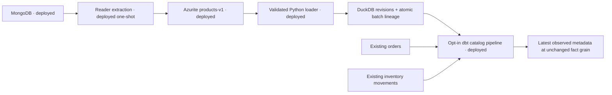

# Product history and analytical enrichment

Status: deployed locally on 2026-11-22, together with the initially paused
[Airflow catalog workflow](catalog-workflow.md). A controlled run loaded 20 products
and built four models with 19 passing build tests. No dashboard change was made.



The diagram records the design stages; the full path is now deployed and verified.
Existing orders/FX and streaming/webhook pipelines retain their current behavior.

## Load contract and lineage

`retailflow.product_catalog` accepts one explicit manifest under
`product-catalog/products-v1/ingestion_date=YYYY-MM-DD/batch=<uuid>/metadata.json`.
It requires an initialized warehouse, does not scan other namespaces or load all
batches implicitly, and needs no MongoDB driver or MongoDB credentials.

The loader validates source/path/date/format/provenance and downloaded byte count
and SHA-256. It rejects duplicate JSON fields and independently revalidates all
products-v1 fields: 20 distinct known IDs, schema version 1, positive BSON int32
revisions, category-specific attributes, bounded variants/markets, unique SKUs,
synthetic markers and canonical BSON UTC dates. Future schema versions need an
explicit compatibility/migration milestone.

| Table | Grain and retained fields |
| --- | --- |
| `raw.product_versions` | `(product_id, revision)`; schema version, SKU, name, category, status, creation/update timestamps, canonical BSON document JSON/hash, first manifest |
| `ops.product_batch_records` | Product/revision membership per manifest and product ID; unchanged products still receive membership in each snapshot |
| Existing `ops.loaded_batches` | Manifest/payload hashes and metadata, retrieved/load times, 20 rows seen and newly observed revision count |

Per-document hashes normalize object-key ordering while preserving BSON wrappers
and array order. The original payload remains in Azurite with its byte checksum.
The source field dictionary remains in [the catalog design](mongodb-catalog.md).

The common warehouse FileLock (0660) covers the full transaction and connection.
Revisions, memberships and the shared ledger commit atomically. A late conflict
rolls back earlier inserts. Changed manifests or changed historical revision
content fail. Creation timestamps remain stable and update timestamps increase
with revisions, matching the supported optimistic-update helper.

Consistent older snapshots may arrive after newer ones without replacing higher
revisions. Skipped revisions are allowed: polling does not prove every update was
seen. Retirement stays in history; missing IDs and physical deletion fail. This
is at-least-once delivery with transactional replay detection, not exactly once.

## dbt models and quality

All new resources are disabled by default; `product_catalog: true` opts in. The
existing inventory source definition is reused without enabling parallel models.

| Model | Meaning |
| --- | --- |
| `stg_product_versions` | All revisions, exact canonical JSON and nested attributes/variants/markets, hashes and original observation/load lineage |
| `current_products` | Highest observed revision per product, including retired products |
| `catalog_orders` | All raw orders at `(dataset_id, order_id)` grain, preserving exact integer minor units, plus current observed metadata |
| `catalog_inventory` | All movements at their original event grain, plus current observed metadata |

Left joins retain unmatched products with NULL metadata and
`catalog_matched=false`. Arrays are not expanded. `catalog_observed_at` is the
first snapshot observation of that revision; later identical snapshots retain
their own membership/ledger evidence. These are **current-metadata** views, not
attributes valid at order time. No historical validity interval, opening stock,
extra revenue or EUR amount is invented. Reporting/dashboard models are unchanged.

The shared lock-aware `catalog-pipeline` action runs source freshness, tagged
per-product freshness tests, then the tagged catalog build. Separate phase
artifacts are retained; failures stop subsequent phases. The demonstration SLA
is **24 hours**, using original ledger retrieval time, not load/replay time.
Per-product checks reject empty, stale and future observations. An old batch
cannot become fresh by replaying it. Extraction is on demand today; activation
needs fresh snapshots or a separately reviewed schedule/SLA.

Quality tests cover product/revision/SKU keys, schema/category/status, document
hashes, manifest lineage, batch membership counts, freshness and exact fact grain,
quantities and minor units. Invalid rows remain visible as failing tests rather
than being silently dropped. The synthetic marker is not a semantic PII detector.

## Verify and operate

With Docker running, these commands use disposable storage and validation images:

```powershell
uv run --locked python -m pytest tests/test_product_catalog.py tests/test_warehouse.py tests/test_dbt_runtime.py -q -p no:cacheprovider
docker build -f infra/duckdb/Dockerfile -t retailflow-duckdb:validation infra/duckdb
docker build -f infra/dbt/Dockerfile -t retailflow-dbt:validation infra/dbt
$env:RETAILFLOW_TEST_DBT_IMAGE = '1'
uv run --locked python -m pytest tests/test_product_catalog_dbt.py -q -p no:cacheprovider
Remove-Item Env:RETAILFLOW_TEST_DBT_IMAGE
uv run --locked sqlfluff lint infra/dbt/project
```

The fixture prepares an anonymous Linux warehouse volume for UID/GID 10001,
preserves setgid 2770 directories/0660 locking, and runs dbt non-root with no
network or source credentials. Tests include retirement, multiple revisions,
unmatched facts, repeated order IDs across datasets, preserved amounts,
corruption and stale/future/empty failures. Only fixture storage is removed.

Validation on 2026-11-22: 66 focused regression tests passed, with three opt-in
checks skipped in that unit run. A separate opted-in run passed both the real
catalog dbt integration and existing default-runtime smoke/parse check. Ruff
lint/format, Bandit, SQLFluff and source safety scanning passed; the latter
reported no findings across 217 source files. The container run emitted an
existing Starlette/httpx deprecation warning; it did not affect the results.
These checks preceded the subsequently approved local deployment described in
[the workflow runbook](catalog-workflow.md); no hosted CI success is claimed.

The deployed explicit loader entry point is:
`python -m retailflow.product_catalog --database <existing-warehouse> --manifest <explicit-manifest>`.
Use an approved runtime with shared warehouse permissions and local BlobStore
configuration. Never attach a host command or desktop viewer directly to the
live Docker volume. Reviewed managed-image updates bake in the loader and
dbt wrapper/models; Terraform image hashes include these inputs.
No new infrastructure root, subscription or dependency is introduced.

The wrapper and `scripts/dbt-dev.ps1` now accept `catalog-pipeline`.
The development command uses the managed warehouse; run it only after explicit
loading/deployment review. It is not a disposable test command.

## Governance and next step

The repository owner owns synthetic product history and enriched views, for local
engineering and analytics demonstrations only. New fields record observed history
and source-to-model lineage; no new customer fields/HMAC-key access are introduced.
DuckDB has no application-user RBAC here; protected volume/host access and the
shared lock remain the boundary. BlobStore still uses an account-wide emulator
key, not prefix RBAC. Community auditing/encryption limitations are unchanged.
This history is not anonymization or a claim of GDPR compliance.

Retain landed source, memberships, revisions, manifests and backups together.
There is no automatic deletion, historical overwrite or live restore. Existing
checkpoint-and-close backups cover the new tables; restore still targets a new
file. Cleanup/correction needs explicit scope and owner review.

The [Airflow catalog workflow](catalog-workflow.md) now connects extraction,
loading and catalog dbt, verified once and left paused. Future image changes still
require saved-plan review, verified landing/warehouse backups and draining affected
writers. Recurring activation and change streams are separate decisions; CDC
requires a reviewed replica-set milestone.
