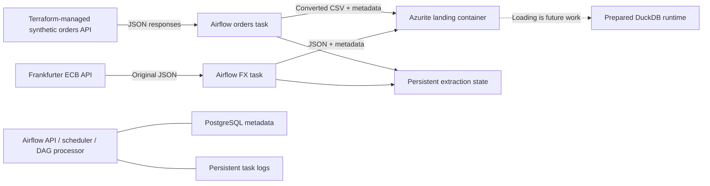

# Terraform-managed Airflow extraction and loading

[Airflow dbt automation](airflow-dbt.md) is deployed; both live three-task verification runs passed.

A [Terraform-managed dbt Core runtime](dbt-runtime.md) is deployed; its managed source checks passed.

The [warehouse-loading extension](warehouse-loading.md) was applied on 2026-11-02.
Both deployed DAGs include downstream `load` tasks using the shared warehouse
volume and common file lock. Existing schedules are enabled.

Status: the approved 15-resource plan was applied and verified on 2026-10-31.
Airflow, PostgreSQL, the managed orders API, and DuckDB are running. Both DAGs
are enabled; scheduled and manual extraction runs have succeeded. Existing Azurite data
was preserved, and the post-apply Terraform plan has no changes. Warehouse loading was added in the subsequent deployment described above.

## Architecture and responsibilities

Terraform builds the orders API and Airflow images and creates their containers,
PostgreSQL metadata storage, persistent logs/checkpoint volumes, local networking,
resource limits, and environment configuration. Python implements extraction;
Airflow owns schedules, task retries, task history, and run visibility.



Airflow 3.3.2 uses LocalExecutor with three long-running components: API server,
scheduler, and DAG processor. A one-shot initializer creates the metadata role
and applies Airflow's metadata migrations. PostgreSQL 17 stores Airflow operational
metadata; it is not the analytical warehouse. No Redis, Celery workers, Docker
socket mount, Kubernetes, or cloud service is introduced.

The applied plan added 15 resources, including three DuckDB resources, without
changing existing Azurite. A subsequent plan has no changes. Docker's existing
default RAM-plus-swap limits were recorded explicitly to avoid perpetual swap
drift; this did not change running limits. Review future plans before applying.

## Schedules and correctness

New DAGs are initially **paused**, use `catchup=False`, permit only one active run
per DAG, and return only small summaries through XCom. In this verified local
deployment both have now been explicitly enabled. For a fresh deployment, verify
container readiness before activation and inspect the first extraction runs.

| DAG | Schedule (UTC) | Destination | Retries |
|---|---|---|---|
| `retailflow_orders` | Every ten minutes | CSV + metadata in Azurite | Two, 30 seconds apart |
| `retailflow_exchange_rates` | Daily at 17:00 | Original JSON + metadata in Azurite | Two, one minute apart |

Orders generation defaults to ten minutes too. The ingestion schedule is fixed
independently of generation settings; a five-second source produces many more rows
per scheduled ingestion. Scheduled FX runs request the closing date of the Airflow
data interval. Airflow 3 manual runs can have no interval; these use the run's
recorded `run_after` timestamp, converted to UTC, rather than the retry's current
clock time. At 17:00 UTC the normal ECB publication time has passed; weekend/holiday
responses retain the provider's actual earlier publication date. Requests are
reference-data snapshots, not live trading quotes.

The first orders run starts with the latest 20 records. Subsequent runs use a
persistent cursor and paginate up to a frozen upper ID captured at run start,
with pages of at most 100 records. Source records becoming available afterward
are handled by the next run. A safety cap limits one task attempt to 2,000 pages;
retry continues from saved progress. `extract_orders(..., initial_after_id=0)`
supports explicit historical extraction before a checkpoint exists; full-history
backfill is not enabled automatically by the DAG or exposed as a UI parameter.

Each page's original response bytes, request URL, and first retrieval timestamp
are staged on the persistent state volume before conversion/upload. Binary bodies
are base64 encoded in local state, so JSON body bytes survive retries unchanged.
Batch IDs are deterministic from Airflow run ID and cursor; retries therefore
reuse identical blobs and metadata. The cursor advances only after the landing
manifest has been written and verified. A crash after upload but before cursor
commit can replay the same page without overwriting different content. Completed
run replay verifies stored batches and avoids new source calls.

FileLock and atomic file replacement serialize checkpoint updates across local
task processes. A dataset version, seed, or generation-interval change fails
explicitly rather than reusing an incompatible cursor. Do not edit/remove state
files while tasks are running. Resetting state intentionally creates a new
bootstrap, and can repeat records across distinct batches. This is retry-safe
landing, not a claim of globally exactly-once processing or cross-batch deduplication.
State and staged responses have no automatic retention/cleanup yet. Filesystem
power-loss durability and distributed/multi-host checkpointing are not implemented.

## Windows setup, review, and eventual activation

Commands run from the repository root. Docker Desktop must have enough memory:
the configured steady-state limits add roughly 4.75 GiB plus Azurite and Docker
overhead. Allow around 8 GiB for Docker, with additional build/download disk space.
This is a larger local setup than the existing Azurite-only service.

```powershell
# Install the updated locked Python dependencies:
$env:UV_CACHE_DIR = Join-Path (Get-Location) '.uv-cache'
.\.bootstrap\packages\bin\uv.exe sync --locked
.\.venv\Scripts\python.exe -m retailflow.infrastructure init
.\.venv\Scripts\python.exe -m retailflow.infrastructure validate
.\.venv\Scripts\python.exe -m retailflow.infrastructure plan
```

`init` adds missing random credentials to ignored `.env`, preserving existing
values. It generates separate PostgreSQL administrator/application passwords,
Airflow UI password, Fernet key, and JWT signing secret. Values are not printed.
The helper passes them as sensitive Terraform variables; state/plans still contain
them and must stay private. `.env.example` documents only empty placeholders.

Only after explicitly approving the concrete combined plan:

```powershell
.\.venv\Scripts\python.exe -m retailflow.infrastructure apply
.\.venv\Scripts\python.exe -m retailflow.infrastructure plan
```

The deployed Airflow UI is at <http://127.0.0.1:8080>, with username
`admin` and the generated `RETAILFLOW_AIRFLOW_PASSWORD` from your local `.env`.
The Terraform-managed source API is at <http://127.0.0.1:18000/docs>. Your
existing manually started API on port 8000 can remain separate. Scheduled tasks
use Docker DNS to reach the managed API and Azurite; they do not depend on a VS
Code terminal. Only Frankfurter requests need internet during extraction.

Check container logs, successful initializer exit, and both parsed DAGs in the UI
first. When ready to begin extraction, explicitly enable and trigger each DAG:

```powershell
docker exec retailflow-airflow-scheduler airflow dags unpause retailflow_orders
docker exec retailflow-airflow-scheduler airflow dags unpause retailflow_exchange_rates
docker exec retailflow-airflow-scheduler airflow dags trigger retailflow_orders
docker exec retailflow-airflow-scheduler airflow dags trigger retailflow_exchange_rates
.\.venv\Scripts\python.exe -m retailflow.blob_storage list
```

Enabling a DAG also permits scheduled runs; do not expect a paused DAG's manual
run to execute normally. For a manual run, inspect its interval or recorded queue
time; the FX date uses the interval end when present, otherwise that queue time.
Verify the first resulting
CSV/JSON batches. If a check fails, pause the affected DAG while investigating:

```powershell
docker exec retailflow-airflow-scheduler airflow dags pause retailflow_orders
docker exec retailflow-airflow-scheduler airflow dags pause retailflow_exchange_rates
```

These post-apply commands are instructions, not evidence they have already run.
Airflow applies the schedules only while the runtime is running. Automated startup
on a host reboot, alert delivery, and production operational support are not configured.

## Security and governance boundaries

- API port 18000 and Airflow UI port 8080 bind only to host loopback. PostgreSQL
  has no published host port. Blob endpoint configuration accepts only the exact
  local loopback or approved Docker service endpoint; arbitrary Azure endpoints
  are rejected before credential use.
- API runs as UID/GID 10001 with read-only root, capability drop, and resource
  limits. Airflow components run as UID 50000/group 0 with capabilities dropped;
  they require writable local runtime/log/state paths. Group 0 is the official
  Airflow image convention, not root UID. PostgreSQL uses its official initializer.
- Only the one-shot initializer receives the separate PostgreSQL admin credential.
  It creates an `airflow` login that owns its metadata database but has no superuser,
  create-database, create-role, or replication privileges. Airflow components use
  that application credential. This restriction was tested with a rejected
  `CREATE DATABASE` statement, not just configuration inspection.
- Airflow SimpleAuthManager is suitable for this local demonstration, not an
  enterprise identity integration. UI credentials are written to a mode-0600
  runtime password file; tokens use a generated shared signing key. No TLS,
  multi-tenant DAG isolation, secret vault, cloud RBAC, or legal compliance is claimed.
- Trusted Airflow roles currently share operational environment credentials and
  state/log volumes. DAG authors and people with Docker access are trusted. The
  state volume contains synthetic orders and public reference rates; operational
  credentials and metadata are private. Do not expose ports or publish state/logs.
  PostgreSQL/checkpoint backup and restore automation is not implemented yet;
  the infrastructure helper's current backup covers landed Azurite blobs only.
- Blob batches retain source, retrieval timestamp, request, and integrity metadata.
  Airflow task history adds run/failure visibility. Freshness alerts, source outages,
  retention enforcement, and warehouse lineage remain future work.

Both container bases are pinned by official image digest. Airflow add-on libraries
use the saved upstream 3.3.2/Python 3.12 constraints; these versions can differ from
the root application's lockfile. The API image installs a hash-checked runtime
export of `uv.lock`. Regenerate it with `uv export --locked --no-dev --no-emit-project
--output-file infra/orchestration/api-requirements.txt` after dependency changes.
The build context explicitly excludes `.env`, state/plans, data, and virtualenvs.
No full image vulnerability scan or SBOM generation has been run in this step.

## Executed checks and remaining validation

Built the API and Airflow validation images. Tests have exercised DAG construction
with the real Airflow SDK, the API serving HTTP under a non-root read-only runtime,
and metadata migration against disposable PostgreSQL. That bootstrap also tested
that Airflow's role cannot create another database. Extraction tests cover ordered
pagination, checkpoint advancement, frozen targets, dataset-change rejection,
and a lost acknowledgement after upload without duplicate or changed retry batches.

The approved Terraform plan added 15 resources without changing existing Azurite.
Final verification on 2026-10-31 passed **78 tests** with all three image/emulator
opt-ins enabled. Terraform formatting/validation, Ruff lint/format, and Bandit
passed. The local dependency audit found no known vulnerabilities. Secret scanning
reviewed and narrowly allowlisted six false positives (environment variable names,
a local path, and an image digest), not credentials. Scanner annotations and
Bandit suppressions cover only those reviewed lines or fixed process launches.
Deployment checks confirmed initializer exit code 0; healthy PostgreSQL, orders
API, and DuckDB; healthy Airflow metadata/scheduler/DAG-processor heartbeats; and
both DAGs discovered and paused. Generated login succeeded (HTTP 201); wrong-password
and unauthenticated API requests were rejected. The scheduler reached the source
API and Azurite through Docker DNS, and the checkpoint volume was writable.
DuckDB passed SQL checks and has no business tables. All 13 pre-apply backup blobs
matched afterward, and two post-deployment live Azurite tests passed. The deployed
metadata role is not superuser and has no create-database or create-role privilege.
The final Terraform plan has no changes.

The initial deployment left DAGs paused. They were subsequently enabled with user
approval, and both scheduled and manually triggered LocalExecutor runs succeeded.
The first manual FX checks exposed an Airflow 3 context difference: the interval
can be absent entirely. The task now uses `context.get("data_interval_end")` and
falls back to the persisted `dag_run.run_after` in UTC. A real-SDK regression test
executes the task body with missing, null, and populated interval contexts; the
corrected manual run succeeded against the live source. Earlier failed attempts
remain in task history for auditability rather than being deleted.

Data verification on 2026-10-31 found four Airflow-produced orders CSV batches with
51 unique, consecutive IDs and checkpoint 96307. CSV business rules, row counts,
and blob checksums passed. The manual FX run requested 2026-10-31 and received
the 2026-10-30 ECB rate of 366.33 HUF/EUR. The landed JSON matched the original
staged HTTP response bytes exactly. These are point-in-time results; enabled
schedules keep adding data. Machine-readable local evidence is saved in ignored
`artifacts/airflow-verification-results.json`.

The Airflow image repair/reconciliation preserved all data volumes. Successful
run history and task logs were verified after container replacement, with healthy
metadata/scheduler/DAG-processor status and both schedules enabled. The final
Terraform plan reports no changes. DuckDB loading remains out of scope.

References: [Airflow deployment](https://airflow.apache.org/docs/apache-airflow/3.3.2/administration-and-deployment/production-deployment.html),
[Airflow constraints](https://github.com/apache/airflow/blob/constraints-3.3.2/constraints-3.12.txt).
