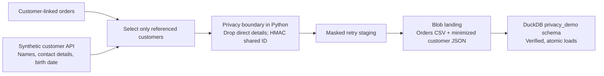

# Synthetic customers and privacy controls

Status: implemented as a separate local demonstration, with disposable-source and
warehouse tests. The new endpoints and loader are not deployed into the existing
Airflow schedules or dbt models. Existing orders-v2/v3 history remains unchanged.

## What we are demonstrating

Customer records exist only for customer IDs referenced by requested orders.
`GET /v2/orders` uses the new `orders-v4` contract and adds `customer_id`.
`GET /v2/customers?order_ids=1&order_ids=2` derives the customers from those exact
orders, deduplicates shared customers, and rejects nonexistent/future orders.
There is no independently populated customer directory. `/v1/orders` retains its
existing contract and remains the source used by scheduled ingestion.

Names are deliberately fictional (`Demo0001 Customer`), email uses
`example.invalid`, phone values are non-dialable labels, and addresses are visibly
fictional. Never replace these fixtures with actual customer records.



The raw customer API response is processed in memory. Unlike the existing orders
and FX pipeline, this path deliberately does not preserve the original identifying
source response. Validation failures stop the batch before publishing a manifest;
error messages do not echo rejected customer values.

## Persisted fields and linking

| Input | Persisted representation |
| --- | --- |
| Customer ID in both sources | Same HMAC-SHA256 customer token, using a private 32-byte key and a versioned key ID |
| First/last name, email, phone, address | Removed |
| Birth date | Broad age band, calculated on the extraction's UTC date |
| Country | Retained for analysis; must match the linked order |
| Synthetic flag | Retained and required to be true |
| Order attributes | Original amounts, currency, country, product and order identity remain |

Only allowlisted fields can enter masked staging, CSV/JSON landing or the new
warehouse tables. The loader checks this again, even if a modified payload has a
valid checksum. Every customer in a batch must have a referenced order, and every
order must have a customer. Multiple orders may share one customer.

Uploads are immutable through BlobStore; files are downloaded and checked before
the checksum manifest is written last. A retry reuses the frozen masked stage
without requesting raw customer details again. Reusing a run ID means replaying
that batch, even if selection arguments change; use a new run ID for new data.
The loader uses the common warehouse FileLock (0660), verifies checksums and
commits orders, dated customer snapshots, batch memberships and the batch ledger
in one transaction.
Changed manifests and conflicting historical records fail instead of overwriting.

## Key handling and local commands

Initialize the key without displaying it:

```powershell
.venv\Scripts\python.exe -m retailflow.customer_ingestion init-key
```

It is generated into the ignored working-directory `.env`. Process environment
takes precedence over `.env`. `.env.example` contains empty configuration fields.
The key is excluded from object metadata, warehouse rows, logs, Docker images and
Terraform configuration/state. Treat it as a secret and retain it securely if
tokens must remain stable. Key IDs are public metadata, not key material.

After a separately reviewed API deployment, manual extraction can use:

```powershell
.venv\Scripts\python.exe -m retailflow.customer_ingestion extract --run-id customer-demo-001 --after-id 0 --limit 20
```

This targets the local API at `127.0.0.1:18000` and the existing loopback/Docker-local
Azurite guard. The output is a manifest path. `load --manifest <path> --database
<existing-disposable-database>` loads only the new `privacy_demo` schema. Use
disposable storage for exploration; do not modify a GUI snapshot that is open or
bypass the managed warehouse's reviewed deployment process.

Rotate by selecting a new key **and** a new `RETAILFLOW_CUSTOMER_PRIVACY_KEY_ID`.
Do not replace a key behind an existing ID. That changes tokens and breaks historical
joins. Cross-version remapping, retention changes and production key management
need a separately reviewed milestone. Existing staged batches reject key-ID changes.

## Governance and limits

The repository owner owns the customer dataset. Classification: synthetic personal
data for engineering demonstrations. Approved uses: testing API integration,
privacy boundaries, joins and quality enforcement. Lineage is the orders-v4
seed/interval, key ID, dated customer snapshot and immutable batch manifest.
No real-person matching, marketing, contact or automated decisions are approved.

This is **pseudonymization and data minimization**, not proven anonymization or a
claim of GDPR compliance. Country, age band, order history and retained order IDs
can still enable linkage. The synthetic source is deterministic and accessible
locally; a token does not make the source irreversibly anonymous. GDPR treats
potentially attributable pseudonymous data as personal data; see
[Recital 26 and Article 4(5)](https://eur-lex.europa.eu/eli/reg/2016/679/oj/eng).

Implemented controls include removal of direct details, keyed identifiers,
allowlisted schemas, no raw-customer retry capture, checksums, atomic loads,
synthetic-only generation and focused regression tests. They illustrate the
[data minimization principle](https://commission.europa.eu/law/law-topic/data-protection/information-business-and-organisations/principles-gdpr_en).

Retention is manual for this local demonstration: remove disposable artifacts
when no longer needed, under the owner's control. No timed deletion or data-subject
request workflow is implemented. Deleting a local table does not remove landed
objects, backups or old snapshots. Any future erasure policy must cover all of
those copies and deterministic source regeneration; existing protected backups
must not be deleted automatically.

Real-person ingestion would require further work, including a lawful basis,
privacy notices, access controls, secure transport, operational secret management,
retention/erasure procedures and assessment of re-identification risk. Local API
authentication and a legal compliance assessment are not provided by this demo.

See the [platform overview](../README.md), [operation guide](runbook.md),
[storage contracts](landing-storage.md) and [warehouse safety rules](warehouse-loading.md).
